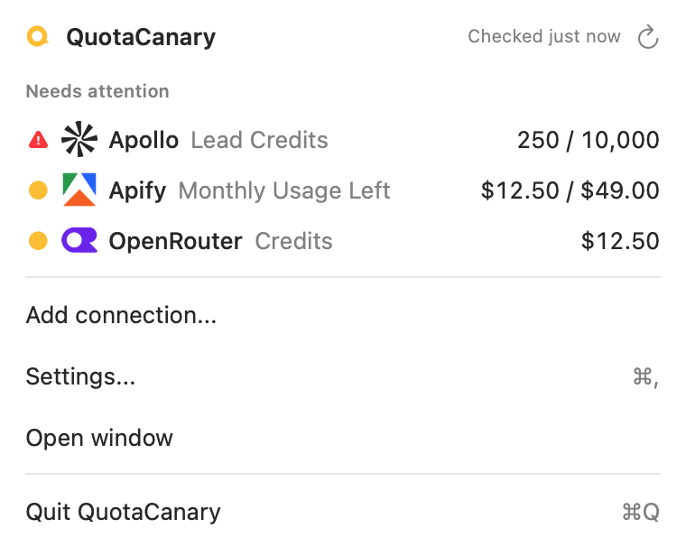

# QuotaCanary

The bird that sings before the credits die.



QuotaCanary is a free, open-source Mac menu bar app that watches the credit balances across your API tool stack. Your vendor keys stay in your Mac’s login Keychain and never go to QuotaCanary servers. Balance requests go directly to each vendor using its key.

If you opt in to update checks, the app sends its app version, macOS version and chip to the signed update feed.

## Use it: QuotaCanary for Mac

**[Download QuotaCanary for Mac](https://quotacanary.com/download/mac)**: a signed, notarized DMG. Or build it yourself with [the Mac build instructions](mac/docs/BUILDING.md).

Requires macOS 26 (Tahoe) or newer. Universal binary; Intel hardware validation is still pending.

- One row per watched balance, with healthy, low and dry status
- Local balance history, burn rate and run-out estimates
- Checks and macOS alerts while the app is running and your Mac is awake and online
- No account; non-synchronizing login Keychain credentials
- Read-only balance requests directly to vendors

## Why this repo exists

1. **Audit it.** Read exactly what leaves your Mac. Start with [SECURITY.md](SECURITY.md) and the source in `mac/`.
2. **Run your own.** Not on a Mac? [Run the web version yourself](docs/SELF_HOSTING.md). You operate its database, encryption key and polling schedule. The HTTP API and MCP server belong to this self-host path; they do not expose the Mac’s local connections.

## Self-hosting (the gist)

```bash
git clone https://github.com/noamdorr/quotacanary-oss.git quotacanary
cd quotacanary
npm install
cp .env.local.example .env.local   # fill in the values
supabase start                     # local Postgres + Auth in Docker
supabase db reset                  # apply schema + tool catalog
npm run dev
```

The self-host web app uses Next.js, React and Supabase. See [the full setup guide](docs/SELF_HOSTING.md) for configuration, scheduling and deployment options.

## Contributing

See [CONTRIBUTING.md](CONTRIBUTING.md). If a tool is missing, [ask for it](mailto:hey@quotacanary.com?subject=Tool%20request) or contribute an adapter.

## License

[MIT](LICENSE)
